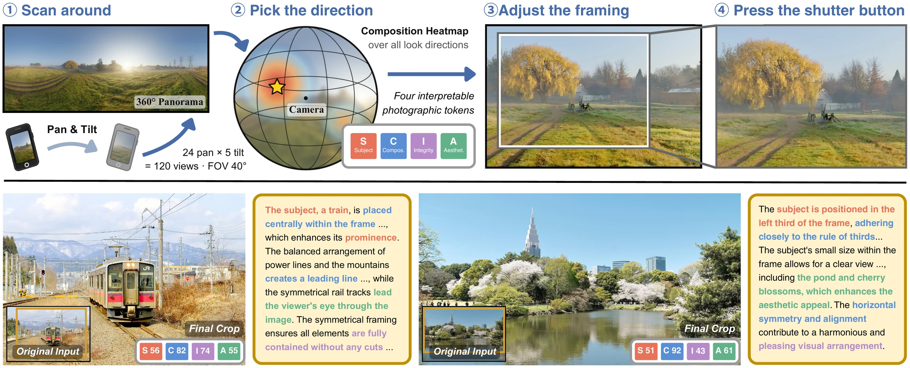
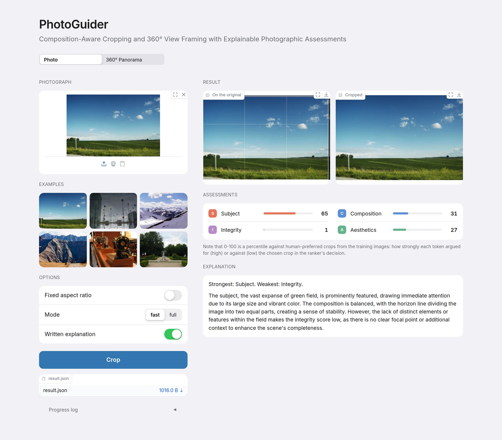
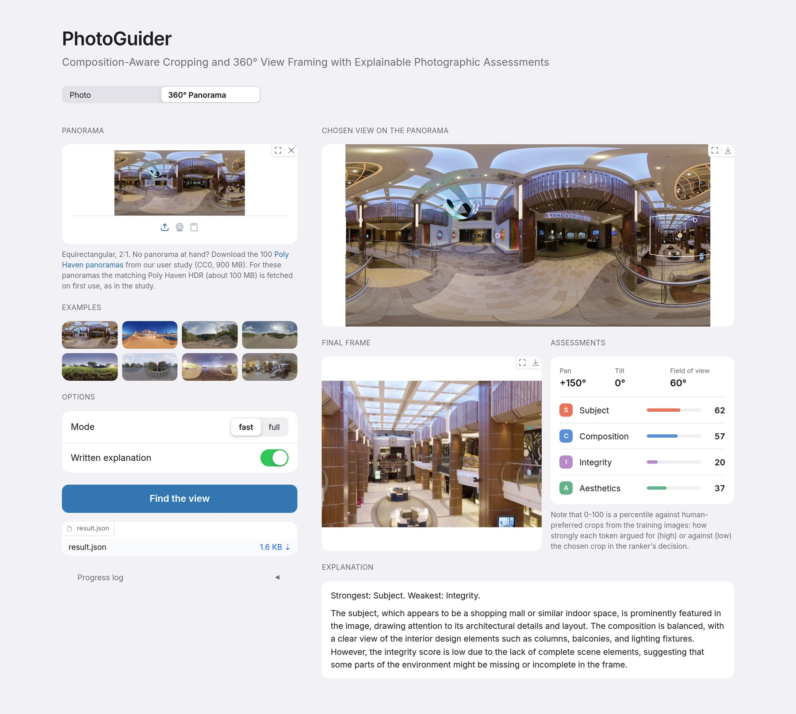

<h1 align="center">
  PhotoGuider: Composition-Aware Cropping and 360° View Framing with Explainable Photographic Assessments
</h1>

<p align="center">
  <a href="https://ntuneillee.github.io">Yuan-Kang Lee</a><sup>1,3</sup> ·
  <a href="https://brianchen1120.github.io">Kuan-Lin Chen</a><sup>2,3</sup> ·
  <a href="https://scholar.google.com.tw/citations?user=FK1RcpoAAAAJ">Chia-Che Chang</a><sup>1</sup> ·
  <a href="https://yulunalexliu.github.io">Yu-Lun Liu</a><sup>3</sup>
  <br>
  <sup>1</sup>MediaTek Inc. · <sup>2</sup>National Taiwan University · <sup>3</sup>National Yang Ming Chiao Tung University
  <br>
</p>

<h3 align="center">
  🌐 <a href="https://ntuneillee.github.io/research/photoguider/">Project Page</a> |
  📄 <a href="https://arxiv.org/abs/2611.02897">Paper</a> |
  🤗 <a href="https://huggingface.co/spaces/NeilLeeNTU/PhotoGuider">Demo</a> |
  📦 <a href="https://github.com/NTUneillee/PhotoGuider/releases/tag/release">Release Assets</a>
</h3>

<p align="center">
  
</p>

**TL;DR** PhotoGuider crops a photograph inside a 360° panorama the way a photographer would, and explains the result with four photographic assessments (Subject, Composition, Integrity, Aesthetics) and a composition explanation.

A photographer scans the scene, picks a direction, adjusts the framing and then presses the shutter. PhotoGuider follows the same steps. It models a photographer’s framing process using four interpretable photographic tokens. These tokens drive a compact ranker for candidate selection, a gated refinement module, and an explainer providing grounded rationales. PhotoGuider achieves competitive performance
across two benchmarks and, to our knowledge, is the first method to combine explicit composition-based direction selection in 360° panoramas with refined framing, camera-parameter output, and measurement-conditioned explanations. User evaluations show clear preference for our crops over end-to-end and MLLM baselines. PhotoGuider combines view selection, crop refinement, and measurement-conditioned explanations in one pipeline.

This repository is the inference release: one photograph (or one equirectangular panorama) in; a
framed crop, its four assessments, the measured subject geometry and, on request, the written
explanation out. The same package reproduces both benchmark tables from frozen feature caches on
the CPU, loading the shipped decision layer without any retraining.

## Table of Contents

- [Repository Structure](#repository-structure)
- [Installation](#installation)
- [Web App](#web-app)
- [Inputs and Data](#inputs-and-data)
- [Running PhotoGuider](#running-photoguider)
  - [Stage 1: Candidates](#stage-1-candidates)
  - [Stage 2: Ranking and Gated Refinement](#stage-2-ranking-and-gated-refinement)
  - [Stage 3: Consultant (full mode)](#stage-3-consultant-full-mode)
  - [Stage 4: Assessments and Explanation](#stage-4-assessments-and-explanation)
- [360° View Framing](#360-view-framing)
- [License](#license)
- [Acknowledgement](#acknowledgement)
- [Citation](#citation)

## Repository Structure

```
.
├── inference/
│   ├── run_image.py          # CLI: one photo -> crop.jpg + result.json
│   ├── serve.py              # resident pipeline server behind app.py (models loaded once)
│   ├── photoguider.py        # library entry: crop_image(...) / Session
│   ├── infer.py              # live crop pipeline (pool -> shortlist -> ranker -> gated refinement -> consultant)
│   ├── reproduce.py          # CPU benchmark: four cells from shipped models + frozen caches (no training)
│   ├── venus_live.py         # live 4-bit decode of the consultant MLLM (Venus), full mode only
│   ├── env_config.py         # envs.toml / environment-variable path resolver
│   ├── models/               # the shipped decision layer (see Configuration)
│   ├── explain_data/         # assessment calibration table + feature -> token map
│   ├── results/              # per-image boxes and explanations behind every headline number
│   └── _lib/
│       ├── release_model.py                      # 60 features, protocols, geometry, gates, blend, ReleaseModel
│       ├── pool_gen.py, pool_sources.py, photog_feats.py         # 8-source conditioned pool
│       ├── aspect_free_pool.py, aspect_free_selection.py         # aspect-free pool + DPP numerics
│       ├── consultant_features.py                # twin featurization
│       ├── feat_saliency.py, dinov3_saliency.py, feat_clip_refine.py   # DINOv3 saliency, InSPyReNet mask, CLIP CAM
│       ├── feature_extractors.py, workers.py     # op -> environment registry, persistent extractor workers
│       ├── explain.py, explain_vlm.py, explain_vlm_worker.py      # assessments, prompt, Qwen2.5-VL explainer
│       ├── pano.py                               # equirectangular rendering, crop -> camera, hotspots
│       └── extractors/                           # per-crop deep-feature scripts, one environment each
├── PanoCropping/
│   ├── scripts/run_pano.py   # CLI: one panorama -> working_view.png + final.png + result.json
│   ├── scripts/score_views.py
│   └── models/               # the GAICD-calibrated additive view scorer and its loader
├── app.py                    # web app (Gradio): photo cropping and 360° view framing in the browser
├── examples/                 # web-app examples: six FCDB/FLMS photos, eight user-study panoramas
├── envs/                     # per-environment requirements, setup script, asset pins and verifier
├── tools/                    # downloads, cache manifest, alignment and results-integrity checkers
├── tests/                    # CPU tests (CI) + the golden benchmark test (needs caches)
├── assets/                   # README figures
├── envs.toml  requirements.txt
└── OUTPUT_SCHEMA.md  CACHE_MANIFEST.md  DATA_TERMS.md  THIRD_PARTY_LICENSES.md
```

## Installation

Linux x86-64, **Python 3.12.7**, an NVIDIA GPU with a CUDA 12.8 driver (the pinned PyTorch wheels
are `cu128`). Live inference needs the GPU model assets; the benchmark reproduction is pure CPU.
Validated revisions, checkpoint hashes and environment versions are in `envs/asset_pins.json`.
Disk: about 45 GB for the six environments plus 5 GB of first-use weights (fast mode), 18 GB more
for Venus (full mode) and 6 GB for the NF4 explainer base (`--explain`; 16 GB if the bf16 Qwen
checkpoint is used instead); about 75 GB for everything.
Panoramas run with `--hdr auto` add about 100 MB per user-study scene for its downloaded HDR.

1. Install the system tools (Debian/Ubuntu) and select Python 3.12.7 as `python3`:

   ```bash
   set -euo pipefail
   sudo apt-get update && sudo apt-get install -y git curl zstd patch tar build-essential python3-venv
   python3 -c 'import sys; assert sys.version_info[:3] == (3, 12, 7), sys.version'
   nvidia-smi
   ```

2. Create the six environments and fetch the mandatory weights for both modes (FGAesQ source and
   checkpoint, SAM ViT-B, LAION aesthetic head; SHA-256 verified):

   ```bash
   bash envs/setup_envs.sh --with-weights
   ```

3. Full mode only: download an immutable Venus snapshot, verify it **before** its remote code
   runs, then apply the supplied tokenizer patch:

   ```bash
   VENUS_REVISION=$(python3 envs/verify_assets.py --revision venus)
   envs/venus/venv/bin/python - "$VENUS_REVISION" <<'PYTHON'
   import json, sys
   from huggingface_hub import snapshot_download
   files = list(json.load(open('envs/asset_pins.json'))['venus_files'])   # exactly the verified inventory
   snapshot_download('popo28/Venus-Q-Stage2', revision=sys.argv[1], allow_patterns=files,
                     local_dir='envs/venus/weights/Venus-Q-Stage2')
   PYTHON
   python3 envs/verify_assets.py --venus
   bash envs/venus/apply_patches.sh
   ```

4. Written explanations only: install the checksum-verified release adapter:

   ```bash
   bash tools/download_explainer.sh
   envs/explainer/venv/bin/python tools/download_explainer_nf4.py   # recommended: the 6 GB NF4 base
   ```

   The explainer is Qwen2.5-VL-7B in 4-bit NF4 with the release adapter. Without the second
   download every explanation fetches and quantizes the 16 GB bf16 checkpoint on load;
   [`PhotoGuider-explainer-nf4`](https://huggingface.co/NeilLeeNTU/PhotoGuider-explainer-nf4)
   is the same quantization saved once (`inference/models/explainer_nf4/`; `tools/save_explainer_nf4.py`
   reproduces it from the base checkpoint). The decoded text is identical either way.

CLIP, DINOv3, InSPyReNet (and the Qwen base model, if the NF4 base is not installed) download on
first use into their library caches; obtain DINOv3 access first (see [`envs/README.md`](envs/README.md)).

## Web App

<p align="center">
  
</p>

`app.py` runs both tasks in the browser. Requests go to one resident pipeline server
(`inference/serve.py`) in the main environment that runs the same code as the CLI with its
extractor models loaded once, so the web app and the CLI return identical results; requests run
one at a time on the GPU. The server loads its models when the app starts, and a request with a
written explanation shows the crop and its assessments as soon as they are known while the
explainer is still writing. After installation steps 1 and 2 (plus 3 for full mode and 4 for explanations):

```bash
python3 -m venv envs/gui/venv
envs/gui/venv/bin/pip install -r envs/gui/requirements.txt
envs/gui/venv/bin/python app.py             # http://127.0.0.1:7860   (--port, --host, --share)
```

**Photo.** Upload a photograph or pick one of six examples (FCDB and FLMS test images on which the
crop is closest to the human crop). Options: a fixed aspect ratio (1:1, 4:5, 3:2, 4:3, 16:9 or 9:16;
off means free-form), `fast` or `full` mode, and the written explanation. The result shows the crop
on the original (thirds lines drawn), the cropped image, the four assessments and the explanation.

**360° Panorama.** Upload an equirectangular panorama (2:1) or pick one of the eight panoramas ranked
highest in the user study; all 100 user-study panoramas are the release asset
[`PolyHaven_panoramas_100.zip`](https://github.com/NTUneillee/PhotoGuider/releases/download/release/PolyHaven_panoramas_100.zip)
(CC0, 900 MB). The result shows the chosen view outlined on the panorama with the scanned hotspots
(gold: the shooting direction), the final frame rendered from the panorama, the camera (pan, tilt,
field of view), the four assessments and the explanation. The web app runs panoramas with
`--hdr auto`: for the examples and the other user-study panoramas it downloads the matching Poly Haven
HDR (about 100 MB) on first use and shoots from the direction the study used, so the results follow
the study.

<p align="center">
  
</p>

Both tabs offer `result.json` for download (see [`OUTPUT_SCHEMA.md`](OUTPUT_SCHEMA.md)) and a
progress log. The example photographs are FCDB and FLMS images, included for non-commercial research
demonstration under the dataset terms (see [`DATA_TERMS.md`](DATA_TERMS.md)).

## Inputs and Data

**Your own photos.** Any format Pillow opens works (JPEG, PNG, WebP, TIFF, BMP); HEIC needs
converting first. Photos with an EXIF orientation tag (most phone shots) are turned upright before
anything else, and inputs above 2048 px run on a bounded working copy; in both cases the box is
reported in the upright full-resolution frame and `crop.jpg` is cut from the full-resolution
original.

**Panoramas.** `run_pano.py` takes one equirectangular image with a 2:1 aspect ratio.

**Benchmarks.** The FCDB and FLMS numbers reproduce on the CPU from the frozen feature caches
(release asset, listed in [`CACHE_MANIFEST.md`](CACHE_MANIFEST.md)) and the FLMS annotations
(fetched from the authors' server, see [`tools/FLMS_GT.md`](tools/FLMS_GT.md)):

```bash
bash tools/download_caches.sh                              # frozen feature caches -> ./caches
bash tools/download_flms_gt.sh                             # FLMS annotations
envs/main/venv/bin/python inference/reproduce.py           # four benchmark cells, ~20 s
envs/main/venv/bin/python tests/test_reproduce_golden.py   # + all 845 per-image boxes
```

FCDB, FLMS and GAICD keep their original terms; what this repository redistributes from them is
described in [`DATA_TERMS.md`](DATA_TERMS.md).

## Running PhotoGuider

```bash
# A photo, free-form framing, with the consultant and a written explanation
envs/main/venv/bin/python inference/run_image.py photo.jpg --mode full --explain --out output/photo

# A photo at a requested aspect ratio
envs/main/venv/bin/python inference/run_image.py photo.jpg --aspect 16:9 --out output/photo_16x9

# A 360° panorama
envs/main/venv/bin/python PanoCropping/scripts/run_pano.py panorama.jpg --mode full --explain --out output/pano

# One of the 100 user-study panoramas, rendered from its Poly Haven HDR as in the study
envs/main/venv/bin/python PanoCropping/scripts/run_pano.py royal_esplanade.jpg --hdr auto --out output/pano
```

The photo command writes `crop.jpg`, the panorama command `working_view.png` and `final.png`; both
write `result.json` as defined in [`OUTPUT_SCHEMA.md`](OUTPUT_SCHEMA.md).

| option | effect |
|---|---|
| `--mode fast` / `--mode full` | `fast` (default) omits the Venus consultant; `full` adds it |
| `--explain` | add the written explanation (explainer environment and adapter required) |
| `--aspect W:H` | photos only: any positive target ratio; without it the framing is free-form |
| `--no-strict-aspect` | photos only: keep the benchmark protocol's per-side border clip instead of the exact ratio |
| `--out DIR` | output directory (required) |

With `--aspect`, the delivered box has exactly the requested ratio: where the refinement step
expanded the box into the image border, the box is shrunk back to the ratio around its centre
before the assessments are computed.

From Python:

```python
import sys; sys.path.insert(0, "inference")
from photoguider import crop_image, Session
with Session() as s:                                   # extractor workers stay resident across images
    for p in ["a.jpg", "b.jpg"]:
        r = crop_image(p, aspect=None, mode="fast", explain=False, out=f"output/{p}", session=s)
        print(r["box"], r["scores"])
```

### Stage 1: Candidates

The conditioned pool is generated on the image; a DPP over the shipped quality model keeps 10
diverse boxes (`models/dpp_quality.pkl`, `dpp_meta.pkl`). Each box gets its 60 features: live
DINOv3 saliency and the InSPyReNet subject mask in-process, per-crop CLIP-L, LAION-aesthetic,
FGAesQ and SAM features through resident workers in their own environments.

### Stage 2: Ranking and Gated Refinement

The four-head LightGBM models plus isotonic calibration (`ranker_*.pkl`) scores the DPP top-3
shortlist (`K_SEL = 3`). Six LightGBM gates (`gate_*.pkl`) then decide whether to recenter the
winner and whether to expand or shrink it; the shrink gate reads the SAM cosine similarity between
the crop and the whole image plus six geometry features.

### Stage 3: Consultant (full mode)

Venus is decoded live (`venus_live.py`); its greedy, multi-box and prompt-ensemble opinions drive
the twin flip and the expanded-opinion blend.

### Stage 4: Assessments and Explanation

The final box is featurized exactly like a candidate, and the ranker's TreeSHAP decomposition is
grouped into the four tokens (`explain_data/token_groups.json`), then mapped to percentiles against
a fixed reference distribution (`dashboard_calibration.json`). The geometry block measures the subject mask inside the box
([`OUTPUT_SCHEMA.md`](OUTPUT_SCHEMA.md) lists each definition).

With `--explain`, the prompt carries the four scores, a one-sentence overview and the measured
geometry, and the fine-tuned Qwen2.5-VL-7B adapter writes at most three sentences. Every positional
statement is grounded in the measured subject mask. Every stage runs on a 16 GB GPU at any input
size: the explainer sees the crop downscaled to at most 1600 × 1067 pixels, the size of the
panorama working view.

## 360° View Framing

`run_pano.py` renders 120 perspective views (24 pans × 5 tilts, 40° FOV) of the equirectangular
input and scores each with the additive view scorer (`PanoCropping/models/`, 40,504 parameters,
trained on GAICD rankings and calibrated to the GAICD 1–5 MOS). It interpolates a dense score
field, takes local maxima, suppresses neighbours within 20° and keeps at most three hotspots by
greedy DPP. The strongest hotspot sets the shooting direction, and a 1600×1067, 60° working view in
that direction goes through `crop_image`. The chosen box becomes camera parameters (centre ray and
horizontal angular width preserved), and `final.png` is re-rendered natively from the panorama at
a 1920-pixel long side. `result.json` adds a `panorama` block (pan, tilt, fov, size, hotspots).
With `--hdr` the working view and the final shot are rendered from the panorama's linear HDR and
exposed for that view, as in the user study; `--hdr auto` downloads the matching 8k HDR from Poly
Haven (CC0, about 100 MB each, MD5 verified, cached in `~/.cache/photoguider/hdr`) when the input is
one of the 100 user-study panoramas, and otherwise renders from the 8-bit panorama. Details and the demo assets are in [`PanoCropping/README.md`](PanoCropping/README.md).

## License

Apache-2.0 for the code ([`LICENSE`](LICENSE)). Third-party models and datasets keep their own
licenses and terms; see [`THIRD_PARTY_LICENSES.md`](THIRD_PARTY_LICENSES.md) and
[`DATA_TERMS.md`](DATA_TERMS.md).

## Acknowledgement

This project builds on
[DINOv3](https://github.com/facebookresearch/dinov3) for saliency,
[InSPyReNet](https://github.com/plemeri/InSPyReNet) for the subject mask,
[CLIP](https://github.com/openai/CLIP) and [OpenCLIP](https://github.com/mlfoundations/open_clip),
the [LAION aesthetic predictor](https://github.com/LAION-AI/aesthetic-predictor),
[FGAesQ](https://github.com/yzc-ippl/FG-IAA) and
[Segment Anything](https://github.com/facebookresearch/segment-anything) as frozen feature backbones,
[Venus](https://huggingface.co/popo28/Venus-Q-Stage2) as the consultant MLLM,
[Qwen2.5-VL](https://huggingface.co/Qwen/Qwen2.5-VL-7B-Instruct) as the explainer base model, and
[LightGBM](https://github.com/microsoft/LightGBM) for the decision layer. It is evaluated on
[FCDB](https://github.com/yiling-chen/flickr-cropping-dataset),
[FLMS](http://fangchen.org/proj_page/FLMS_mm14/) and
[GAICD](https://github.com/HuiZeng/Grid-Anchor-based-Image-Cropping), and the demo panoramas are
CC0 HDRIs from [Poly Haven](https://polyhaven.com/hdris).

## Citation

```bibtex
@article{lee2026photoguider,
  title={{PhotoGuider}: Composition-Aware Cropping and 360° View Framing with Explainable Photographic Assessments},
  author={Yuan-Kang Lee and Kuan-Lin Chen and Chia-Che Chang and Yu-Lun Liu},
  journal={arXiv preprint arXiv:2611.02897},
  year={2026}
}
```
